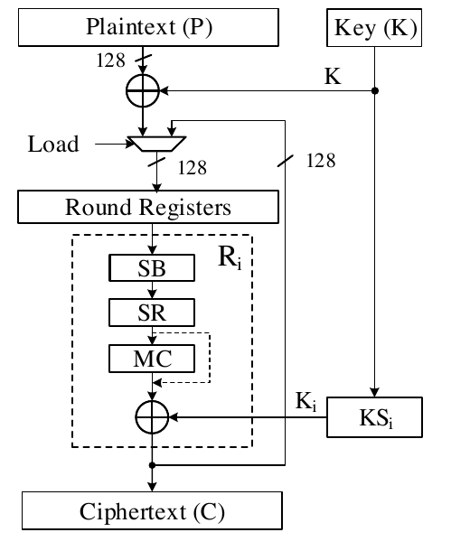
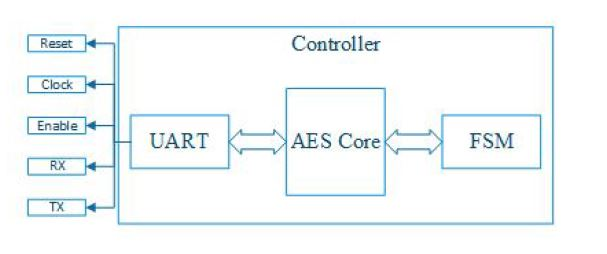

# Project: 128-bit AES implementation in a FPGA and verification using c/c++/Python

**ELEC 5210/ELEC 6210: Hardware Security I**  
Dept. of Electrical and Computer Engineering  
Auburn University, AL

## Abstract

In this project, you will develop an AES encryption engine and then implement it in an FPGA. You will verify the results of your design, implemented using hardware description language (HDL), using the c/c++/Python program. The project consists of five parts. Due dates will be listed as the semester progresses. Please read the problem definitions of all six parts before actually starting the project. Please submit only the List Format of the simulation results not waveform. Always annotate your simulation results. If you change anything in the project that was not part of the plan or you want to make some modifications, please attach an errata sheet explaining the changes with the next report. You can use Verilog or VHDL for RTL development. However, the software project must be in c/c++/Python. After the completion of the project, students are required to submit a complete project summary report by the deadline.

**Note:** Copy and paste all RTL code and testbenches as text (not screenshots); the same instruction applies for c/c++/Python programs. Only submit screenshots for simulation results or terminal outputs.

## Part I: Development Environment, and UART Communication [15 points]

**Assigned:** 9/1/2026  
**Due:** 9/23/2026

### A. Setup Development Environment

We will use [Nexys4DDR (Artix-7) FPGA board](https://reference.digilentinc.com/_media/nexys4-ddr:nexys4ddr_rm.pdf) for this project. Digilent Inc. provides step by step instruction on how to use Vivado design suite and Nexys4DDR board. First, follow [this link](https://reference.digilentinc.com/reference/programmable-logic/nexys-4-ddr/start) to setup the integrated development environment (IDE) in your personal computer. You have to register and get a free web-pack license from [Xilinx's website](https://www.xilinx.com/). Second, familiarize yourself with the [Vivado design flow](https://www.xilinx.com/content/xilinx/en/video/hardware/vivado-design-flows-overview.html). Go ahead and watch some tutorials on Xilinx's [knowledge base](https://www.xilinx.com/support.html).

### B. UART Communication Exercise

1. Configure a UART module. HDL code for UART can be found in [https://www.nandland.com/vhdl/modules/module-uart-serial-port-rs232.html](https://www.nandland.com/vhdl/modules/module-uart-serial-port-rs232.html). (you may use an open-source HDL implementation)
2. Design a simple 4-bit adder circuit, synthesize the design with the UART interface, and program it onto the FPGA. For the RTL code, you may look at [this example](https://www.chipverify.com/verilog/verilog-full-adder).
3. Use a serial terminal such as [RealTerm](https://sourceforge.net/projects/realterm/) to send two input numbers, perform the addition in the FPGA, and display the result returned over UART. Document your results by submitting the RTL code you used, adder testbench simulation output, a screenshot of the terminal showing correct transmit/receive operation.

## Part II: Overall Architecture, and Sbox Implementation [15 points]

**Assigned:** 9/23/2026  
**Due:** 10/2/2026

### A. Architecture

The AES design selected for this project should be a multicycle architecture. At this stage, you should decide the design details and different modules/components to be incorporated in your design. A reference multicycle AES design is shown below, where 128-bit data after each round is stored in round registers to be treated as an input for the next round computation in the next clock cycle:

1. Sketch (you can use this [website](http://www.draw.io)) the data-path for AES module. Label all the modules properly.
2. Describe each module, its I/O pins width, and how you want to implement it. There can be many schemes that you can follow. For example, Sbox module can be implemented in the dedicated RAMs or distributed memories (CLBs). Choose a method that makes your design efficient and faster.
3. You must report how you want to implement each block and why.

Since the data block is 128-bit, you need to interface an UART module (simple LED cannot be used to display the results). Note, you do not need to design an RTL for the UART. You can use an IP or download a library. Here is a sample Top-level design that may help you to visualize the final design:

### B. Sbox Implementation

Lets begin the design. Sbox is the lowest level module in the AES design.

1. Design an HDL module and simulate. Your module may look like this: `Sbox(address[7 : 0], SboxData[7 : 0])`.
2. Write a subroutine in c/c++/Python and show that your results correspond to RTL simulation for verification.
3. Attach the codes and simulation data along with the **report**. Make sure to add necessary comments throughout the code for better understanding.

## Part III: Shift-row and Mix-column Implementation [15 points]

**Assigned:** 10/2/2026  
**Due:** 10/14/2026

1. Design the Shift-Row and Mix-Column modules and simulate.
2. Connect these two modules along with the Sbox and simulate.
3. Similarly, write c/c++/Python code for Shift-Row and Mix-Column operation. You should get the same results for HDL and c/c++/Python.
4. Include codes and results in the **report**. Print you code from a text editing software (e.g., notepad++). Use appropriate header and be consistent with it. Provide sufficient comments.

## Part IV: Key Expansion, Key Addition and One Complete Round Implementation [15 points]

**Assigned:** 10/14/2026  
**Due:** 10/26/2026

1. Design key expansion module and simulate. Use one key consistently throughout the design. It would make the debugging easier.
2. Connect it with the previous modules and simulate. You will need to incorporate key addition (XOR, ⊕). Congratulations! You have a complete round for an AES now.
3. Do the same in c/c++/Python.

Include codes and results in the **report**.

## Part V: Complete AES Simulation [15 points]

**Assigned:** 10/26/2026  
**Due:** 11/13/2026

1. Complete the design both in HDL and c/c++/Python.
2. Use a python script and AES library to verify the correctness of your designs. Use Electronic Code Book (ECB) mode for verification. (*This project is essentially implementing AES in ECB mode. With the same 128-bit plaintext under a fixed encryption key, we always have the same ciphertext as the output.*)

   [Other modes of operations like Cipher Feedback mode (CFB), Output Feedback mode (OFB), Cipher Block Chaining Mode (CBC) produce ciphertext that not only depends on the key and the current 128-bit plaintext, but also depends on the previous 128-bit plaintext and/or ciphertext which the AES module had received prior to the current plaintext. Our project does not need to implement these.]

## Part VI: Hardware Implementation and a Working AES Demo [25 points]

**Assigned:** 11/13/2026  
**Due:** 12/2/2026

You will have to show the implemented design on your FPGA Board. You will be conducting a demo as follows:

1. Program the FPGA with your synthesized AES design and interface logic.
2. Demonstrate encryption by sending plaintext input over UART, observing the ciphertext output, and verifying correctness.
3. Briefly explain the design components, what program you are running, and what result is expected.
4. Run the program pointing to the functions of the buttons you press.
5. Offer to make a change to some parameter to a viewer-selected value and rerun the demo.
6. Total duration of demo: FIVE MINUTES.

## Design Tips (RTL)

1. Be sure to test the modules as thoroughly as possible.
2. For RTL synthesis, keep an eye on the timing report in the Vivado. If your timing slack is not positive, it means your clock frequency is running faster than it is supposed to be. You can reduce the clock speed or make the critical path shorter by optimizing the design.
3. Check the utilization of your FPGA.
4. Its better to use default clock frequency and derive clock internally if needed according to the module requirements.
5. Use Reset to initialize the finite state machine (FSM).
